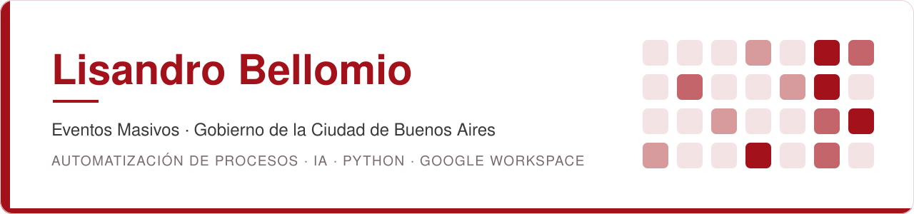

  

  
  

### Sobre mí

Trabajo en **Eventos Masivos del Gobierno de la Ciudad de Buenos Aires**, en el seguimiento y la planificación de eventos de gran convocatoria. Me interesa usar herramientas de IA para automatizar tareas repetitivas y ordenar la información del día a día.

### Proyectos

| Proyecto | Qué hace |
|---|---|
| **[automatizaciones-eventos](https://github.com/Lichabellomio/automatizaciones-eventos)** | Tareas programadas con Claude que arman el informe semanal de eventos y mantienen actualizado el seguimiento de fechas a partir de WhatsApp y Google Docs. |
| **[Primer-Parcial](https://github.com/Lichabellomio/Primer-Parcial)** | Primeros ejercicios en Python: números primos, bucles y entrada por consola. |

### Herramientas

  
  
  
  
  

